<div align="center">

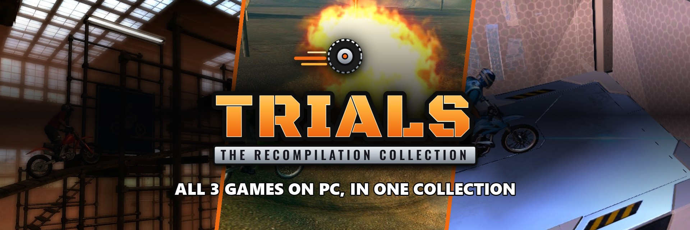

### Trials HD, Trials Evolution and Trials Fusion on PC, running natively, with their DLC, in one launcher made for the couch.

[](https://github.com/TekRantGaming/Trials-ReVolution-Collection/releases/latest)
&nbsp;
[](https://discord.gg/8eakYSvBZS)

[](https://github.com/TekRantGaming/Trials-ReVolution-Collection/releases/latest)
[](https://github.com/TekRantGaming/Trials-ReVolution-Collection/releases)


<br>

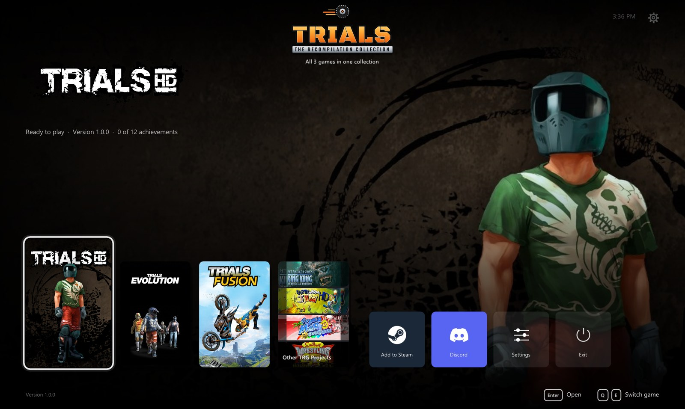

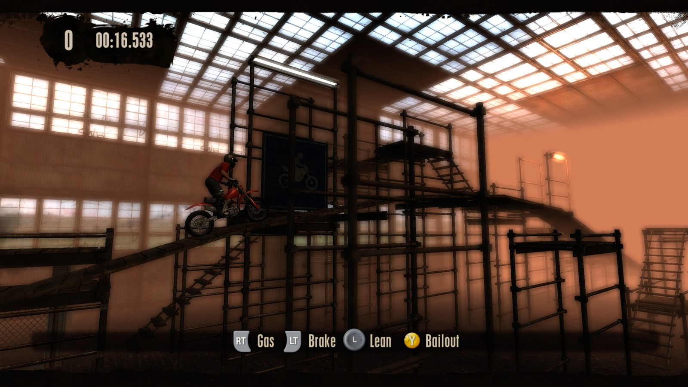
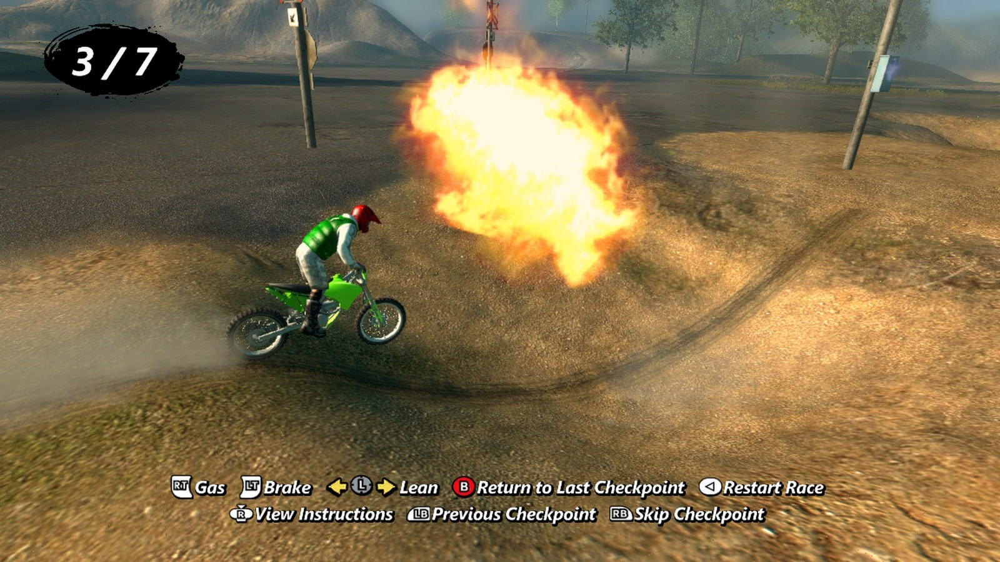
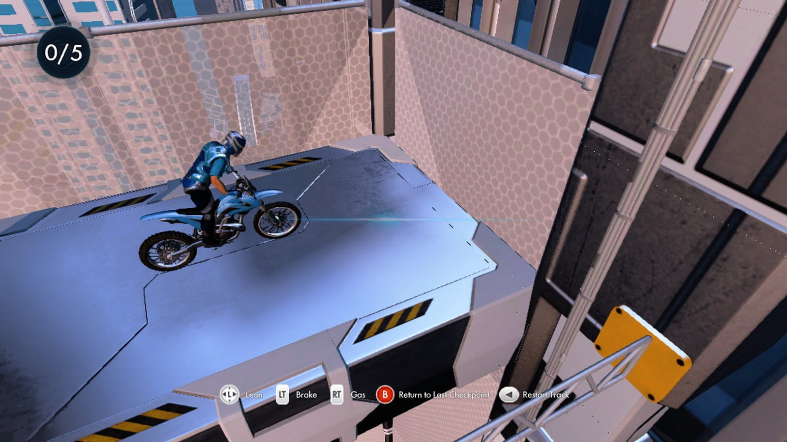

<sub>The original Xbox 360 game code, translated to native PC code with the <a href="https://github.com/rexglue/rexglue-sdk">ReXGlue SDK</a>. <b>No game files included</b>: bring your own copy of each Xbox Live Arcade game.</sub>

<sub><b><a href="#why-recompile-the-original-trials-trilogy-when-gold-edition-already-exists-on-pc">Why recompile the original Trials trilogy when Gold Edition already exists on PC?</a></b></sub>

</div>

<br>

## At a glance

| | | |
| :--- | :--- | :--- |
| 🏍️ **All 3 games** in one launcher | 🖥️ **One resolution setting**, up to 4K; Trials HD at 60, 90, 120 or an **unlimited** frame rate | ✨ **AMD FSR 1 and NVIDIA NIS** upscaling to your resolution |
| 📀 **DLC for all 3 games**: Big Pack, Riders of Doom, every Fusion pack and more, from your own packages | 🎮 **Any controller**, or the keyboard with your own keys | 🏆 **Achievements** with notifications in game |
| 📦 **Install from your own packages**, found on your PC by themselves | 🔓 **The full game, always**: never the trial version | 🔄 **Updates itself** and every game |
| 💾 **Save backups** and restore in one click | 🛋️ **A console style dashboard** with sounds, made for a controller | 🪟 **Borderless fullscreen**, windowed, any monitor |
| 🚂 **Add to Steam** with its own artwork, ready for Big Picture | ↩️ **Back to the launcher** any time: hold Back + Start, or Esc | 💬 **[Join the Discord](https://discord.gg/8eakYSvBZS)** right from Home |

## Why recompile the original Trials trilogy when Gold Edition already exists on PC?

While [*Trials Evolution: Gold Edition*](https://store.steampowered.com/app/220160/Trials_Evolution_Gold_Edition/) is available on Steam, it does not faithfully preserve the original Xbox 360 releases.

The Trials HD content was rebuilt using Trials Evolution's engine, resulting in different physics and changes to the original tracks. This means Gold Edition does not provide the exact same gameplay experience as the original Trials HD.

Furthermore, Gold Edition excludes all four major DLC expansions released for Trials HD and Trials Evolution (Big Pack, Big Thrills, Riders of Doom and Origin of Pain), leaving over 150 additional tracks and other content unavailable in the PC release.

| Missing from Gold Edition | |
| --- | --- |
| The original Trials HD physics | rebuilt on the Trials Evolution engine |
| Four major DLC expansions | Big Pack, Big Thrills, Riders of Doom, Origin of Pain |
| Additional tracks | 151 |

Our goal is not to replace or compete with Ubisoft's existing PC releases. It is to preserve the original Xbox 360 versions of Trials HD, Trials Evolution and Trials Fusion as faithfully as possible, including their original physics, gameplay mechanics, content and individual identities.

By recompiling the original games into native PC executables, we aim to provide a long term preservation solution while also exploring modern improvements such as higher resolutions, improved compatibility, performance optimisations and independent community functionality.

**Gold Edition lets you play much of the classic Trials content. Our goal is to preserve the original games themselves.** If you would like to play it, [Trials Evolution: Gold Edition is on Steam](https://store.steampowered.com/app/220160/Trials_Evolution_Gold_Edition/); the launcher has a page about it on Home too.

## The games

<div align="center">

### Trials HD

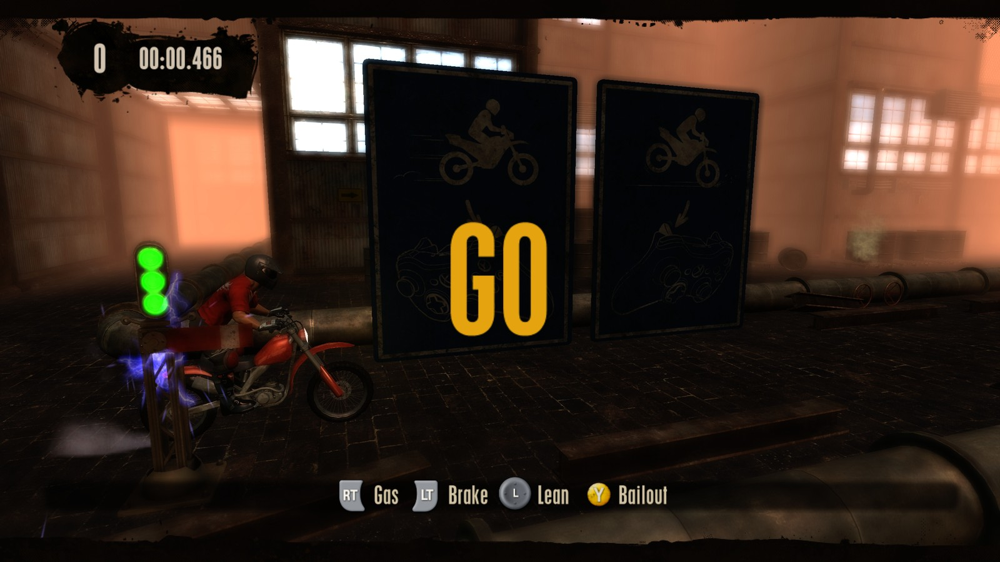

<sub><b>Where it all began.</b> One bike, one rider and a warehouse full of obstacles, all down to throttle, brake and balance.</sub>

<br><br>

### Trials Evolution


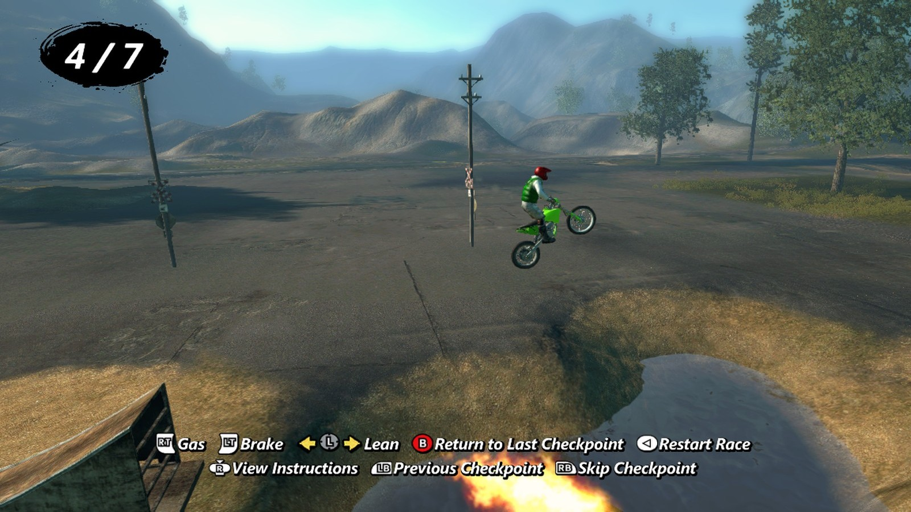
<sub><b>The tracks leave the warehouse.</b> Huge outdoor tracks, explosions and the Career from the D License up.</sub>

<br><br>

### Trials Fusion


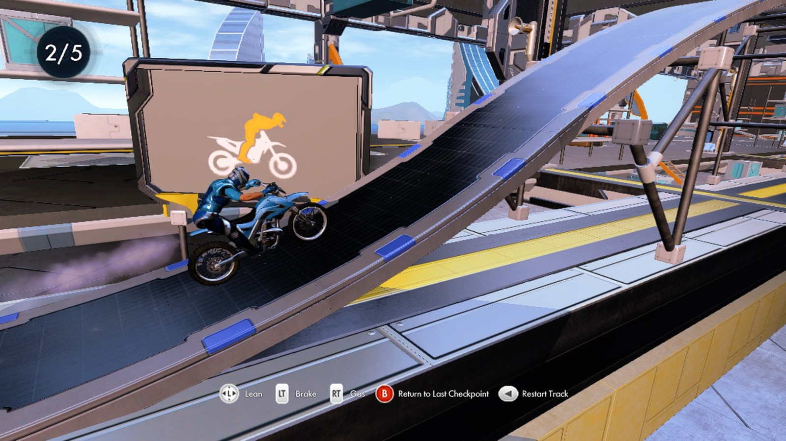
<sub><b>Tricks and tracks in a bright future.</b> Futuristic cities, new bikes and the tracks of the whole Career.</sub>

</div>

<br>

## Getting started

**You need:** Windows 10 or 11 (64 bit) with a DirectX 12 graphics card, and the Xbox Live Arcade package of each game you want to play, copied from your own console (see [Which packages you need](#which-packages-you-need)).

1. Download **TrialsCollection-...-windows-x64.zip** from the [latest release](https://github.com/TekRantGaming/Trials-ReVolution-Collection/releases/latest) and unzip it anywhere. It holds the launcher and all three games, and everything stays in that folder, so it's portable.
2. Run **trials_launcher.exe**. It opens in fullscreen on Home. Windows may warn about an unknown publisher the first time: choose **More info**, then **Run anyway**.
3. Pick a game and press **Play**. The first time, the launcher asks for your copy of that game: it finds packages on your PC by itself (or choose the package file, or a folder it was already extracted to), checks it really is that game and copies the game files next to the game.
4. Press **Play** again, and from then on it starts straight away.

While you play, **hold Back and Start** on the controller, or **hold Esc**, to come back to the launcher. **No game files are included**: they come from your own copies. Xbox Live Arcade games run as their trial unless they were bought, so the collection always unlocks the full game: please only use copies you own. Your saves are kept in `Documents\trials_hd`, `Documents\trials_evolution` and `Documents\trials_fusion`.

### Which packages you need

Each game is one file on your console's storage, in `Content\0000000000000000\<title ID>\000D0000`. Only the title ID is checked, so any copy of these games works. These are the packages the ports were made and tested with:

| Game | Title ID | Media ID | Version | Package | SHA1 | Installed |
| --- | --- | --- | --- | --- | --- | --- |
| Trials HD | `5841095A` | `22E417BF` | `0.0.1.2` | 217,092,096 bytes | `CAD16E3104B3C584773E1A3F813DF923642CBA94` | about 210 MB |
| Trials Evolution | `58410AAD` | `739182AD` | `0.0.0.3` | 1,316,257,792 bytes | `6BD8FBCDFC45911F1317D462DC24440C1F277BA1` | about 1.3 GB |
| Trials Fusion | `58411401` | `5AF34C9D` | `0.0.0.3` | 1,632,141,312 bytes | `5695B9CB78B1A1925043874DAA83BBF7564CE2AA` | about 1.6 GB |

Title updates are not supported yet. The launcher's install screen shows every detail for each package, MD5 and CRC32 too. To check a package yourself, run this in PowerShell and compare the result with the SHA1 above:

```powershell
Get-FileHash "C:\Games\Trials HD\6E133151FC02CFA6D6653C9AAE46D1DC8014605158" -Algorithm SHA1
```

### Downloadable content

Each game's page has **Add DLC** next to Play. It lists that game's DLC; press **Install** on one and choose your own package of it, from your console's `Content\0000000000000000\<title ID>\00000002` folder, or the zip it is in. The launcher checks it really is that DLC and installs it for every profile. Installed DLC can be removed again from the same page.

| Game | DLC |
| --- | --- |
| Trials HD | Big Pack, Big Thrills |
| Trials Evolution | Riders of Doom, Origin of Pain |
| Trials Fusion | Riders of the Rustland, Empire of the Sky, Welcome to the Abyss, Fire in the Deep, Fault One Zero, After the Incident, Fallen Angel Bike Upgrade, and the Exclusive Content, Uplay Rewards and Season Pass Unlocks (a profile file, `58411401.gpd`) |

The Fusion unlocks are merged into your profile's settings, keeping your own options and progress; your settings are backed up first, and Remove puts them back.

## The launcher

Everything is set up before a game starts, with a controller, the keyboard or the mouse. Each game has its own page and its own settings.

<table>
<tr>
<td width="55%"></td>
<td valign="middle">

### Home
- **All three games** side by side, with their box art and artwork
- Each game shows at a glance whether it's **ready to play**, its version and your **achievements**
- **Settings** for the launcher, and **Other TRG Projects**
- **Trials Evolution: Gold Edition**: Ubisoft's Steam release, with its description and a link to its store page
- **Add to Steam**: adds the collection to your Steam library as a non Steam game, with its own artwork (cover, banner, header, logo and icon), and switches Steam Input off for it so your controller keeps working
- **Discord**: joins the official server
- Plays with a **controller**, the **keyboard** or the **mouse**, with interface sounds

</td>
</tr>
<tr>
<td valign="middle">

### Game page
- **Play**, the only place a game starts
- **Add DLC**: the game's DLC, each one installed from your own package
- **Settings** and **Saves and install** for that game
- Your **achievements** so far, your **save backups** and the **release notes** of its latest version

</td>
<td width="55%">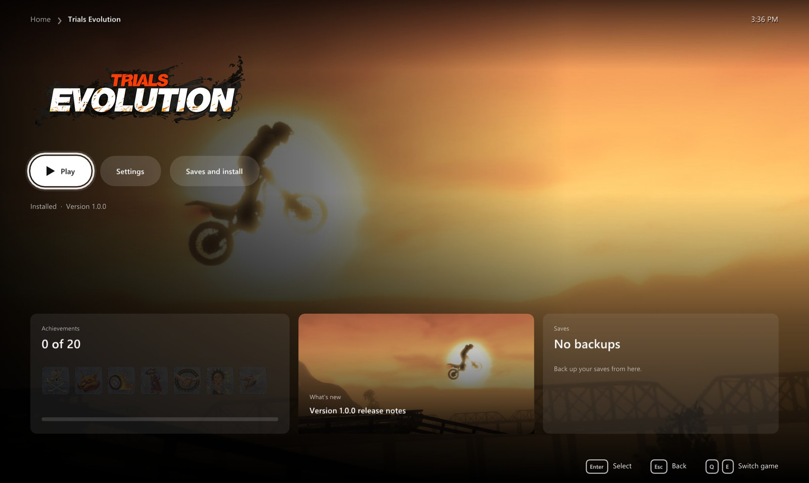</td>
</tr>
<tr>
<td>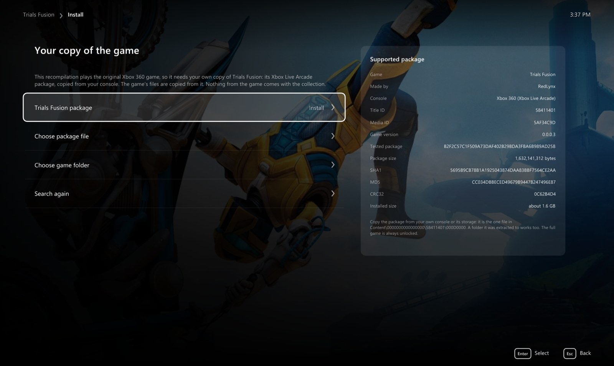</td>
<td valign="middle">

### Install from your own copy
- The launcher **finds packages** on your PC by itself, or you **choose the package file** or an **extracted folder**
- A card shows **exactly which package works**: title ID, media ID, version, size, SHA1, MD5 and CRC32
- It checks the package really is that game, then copies the files with a progress bar

</td>
</tr>
<tr>
<td valign="middle">

### Display and Graphics
- **Fullscreen** or **windowed**, **choose the monitor**, vertical sync
- **Resolution**: one setting for the game and the window. The game draws for it, and in a window the window has that size
- **Frame rate** in Trials HD: **Original** (60, like the Xbox 360), 90, 120 or **unlimited**, with the physics at its own 60 steps a second. Trials Evolution and Trials Fusion run at 60: their game speed follows the frame rate
- **Upscaler**: AMD FSR 1 or NVIDIA NIS, scaling to your chosen resolution (not just your screen), with Native, Quality, Balanced and Performance modes. With it off, Trials HD draws at your resolution itself. Trials Evolution and Trials Fusion always draw at their original 720p, as on the Xbox 360 (drawn larger, their colors, textures and scenery break), and the upscaler takes them to your resolution
- **Anti aliasing**: **FXAA** or FXAA strong, and **texture filtering** up to 16x
- **Keep the original shape** with black bars, or stretch to fill

</td>
<td width="55%">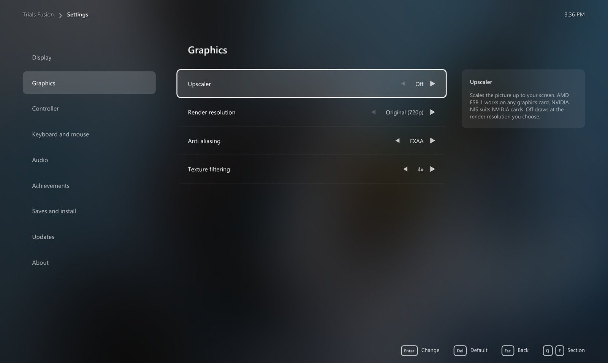</td>
</tr>
<tr>
<td>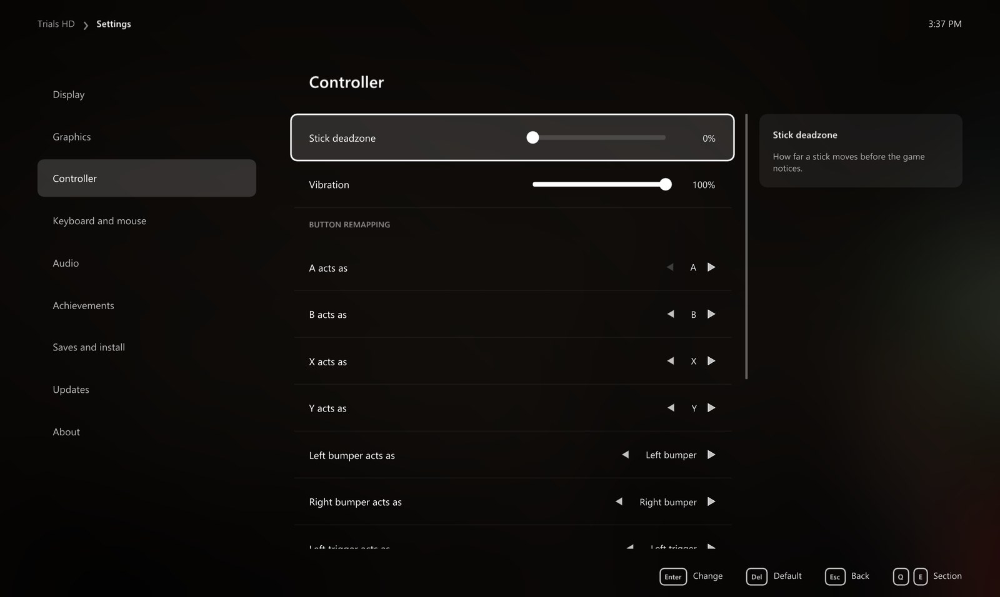</td>
<td valign="middle">

### Controller and keyboard
- **Stick deadzone** and **vibration** strength
- **Remap any button** on your controller, in the menus too
- **Keyboard** play with your own key bindings

</td>
</tr>
<tr>
<td valign="middle">

### Achievements
- All the achievements of each game, with their pictures and gamerscore
- **Notifications in game** when you unlock one, with their sound on or off and its volume
- A **test button** to see and hear it

</td>
<td width="55%">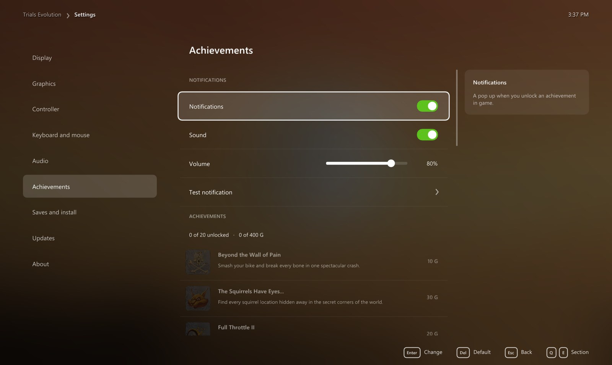</td>
</tr>
<tr>
<td>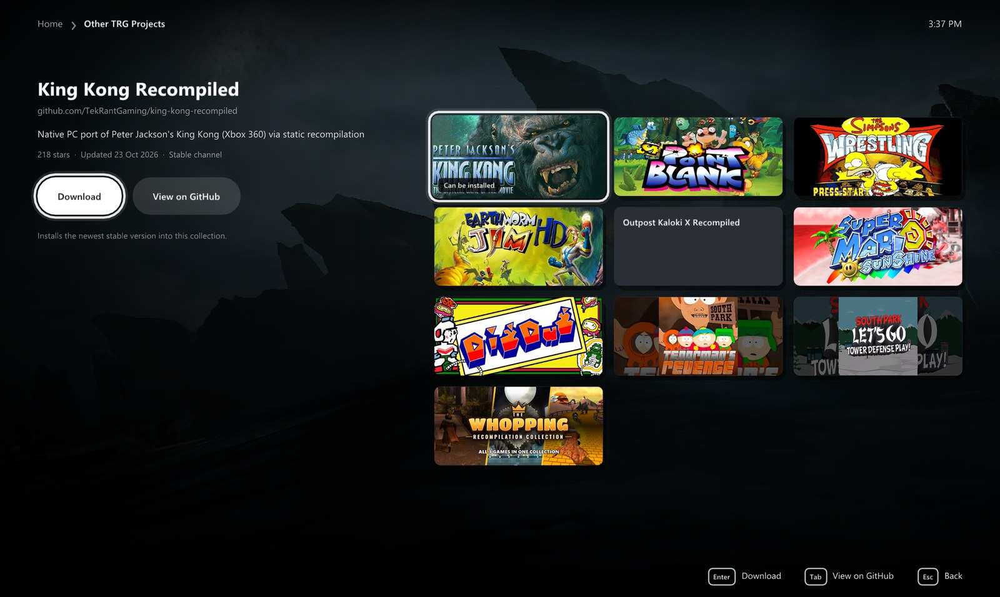</td>
<td valign="middle">

### Other TRG Projects
- The other **TekRantGaming** ports, with their artwork and a link to each
- **King Kong Recompiled** downloads and plays right from here

</td>
</tr>
</table>

### Saves and updates

Each game's **Saves and install** page backs up your saves and restores them, opens the save, backup and game folders, reinstalls from your copy or removes the game. When the launcher opens it checks GitHub for new versions of itself and of each game and **installs them by themselves**, restarting into a new launcher once nothing else is going on; your games, saves and settings stay as they are. Turn that off in the launcher's own **Settings**.

## Xbox 360 vs PC

| | Xbox 360 | PC |
| --- | :---: | :---: |
| Resolution | 1280 x 720 (Evolution and Fusion a little less) | your choice, up to 4K |
| Frame rate | 60 fps | Trials HD 60, 90, 120 or unlimited; Evolution and Fusion 60 |
| Upscaling | none | AMD FSR 1 or NVIDIA NIS, to your resolution |
| Downloadable content | Xbox Live | all of it, from your own packages |
| Anti aliasing | console | FXAA, or higher resolutions |
| Texture filtering | console | up to 16x |
| Display | TV | borderless fullscreen or windowed, any monitor |
| Controls | Xbox 360 controller | any controller, remapping, keyboard |
| Achievements | console | notifications in game, with sound |
| Three games | three downloads | one launcher |

## Good to know

### Hotkeys

| Key | Action |
| --- | --- |
| Hold <kbd>Back</kbd> + <kbd>Start</kbd>, or hold <kbd>Esc</kbd> | back to the launcher while playing |
| <kbd>F11</kbd> | the launcher fullscreen or windowed |

### Known limits

- **No online play**: leaderboards, multiplayer and Track Central need Xbox Live.
- **No title updates** yet: the games run as their first release.

### Reporting a problem

Please open an [issue](https://github.com/TekRantGaming/Trials-ReVolution-Collection/issues) with the game, what happened, your CPU, graphics card and the resolution and frame rate you play at, or ask on the [Discord](https://discord.gg/8eakYSvBZS).

## About the games

*Trials HD* (2009), *Trials Evolution* (2012) and *Trials Fusion* (2014) were made by RedLynx. Trials HD and Trials Evolution were published by Microsoft Studios on Xbox Live Arcade, Trials Fusion by Ubisoft. Each is a physics driven motorbike game: throttle, brake and the rider's balance against tracks full of ramps, loops and explosions.

*Trials: ReVolution Collection* runs the Xbox 360 versions natively on Windows, with their downloadable content, and adds the options you would expect from a PC release.

<details>
<summary><b>Building from source (for developers)</b></summary>

See [BUILDING.md](BUILDING.md). The game code is generated from each game's own `default.xex`, so building a game needs your own copy too.

</details>

## Credits

- **Trials HD**, **Trials Evolution** and **Trials Fusion** by RedLynx, published by Microsoft Studios and Ubisoft.
- [**ReXGlue SDK**](https://github.com/rexglue/rexglue-sdk), which does the code translation and runs the games, built on the work of [**Xenia**](https://github.com/xenia-project/xenia) and [**XenonRecomp**](https://github.com/hedge-dev/XenonRecomp).
- [**Trials HD Recompiled**](https://github.com/snufflyyy/trials-hd-recompiled) by snufflyyy (MIT): the first recompilation of Trials HD, its function list, the frame smoothing above 60 FPS and the package reader. See [THIRD_PARTY_NOTICES.md](THIRD_PARTY_NOTICES.md).
- [**Dear ImGui**](https://github.com/ocornut/imgui), [**SDL**](https://www.libsdl.org) and [**stb**](https://github.com/nothings/stb) for the launcher.
- The [**TRG Launcher**](https://github.com/TekRantGaming/trg-launcher) (updater and settings), shared by the TekRantGaming ports.
- Game artwork in the launcher from [**SteamGridDB**](https://www.steamgriddb.com), downloaded when the launcher runs. The collection's logo and Steam artwork are made from the original *Trials Evolution: Gold Edition* art.
- The Discord and Steam marks from [**Simple Icons**](https://simpleicons.org) (CC0). Discord and Steam are trademarks of their owners.
- Upscaling: [**AMD FidelityFX Super Resolution 1**](https://github.com/GPUOpen-Effects/FidelityFX-FSR) and the [**NVIDIA Image Scaling SDK**](https://github.com/NVIDIAGameWorks/NVIDIAImageScaling), both MIT licensed.

> [!NOTE]
> **AI disclosure:** this collection was made almost entirely with Claude Code (Anthropic). The repository owner directed and tested the work; the AI did the analysis, code, tools and documentation.

> [!IMPORTANT]
> This project is not affiliated with or endorsed by RedLynx, Ubisoft, Microsoft, Valve or Discord. All trademarks belong to their owners. It contains no game code or assets. Do not open issues asking for game files.
